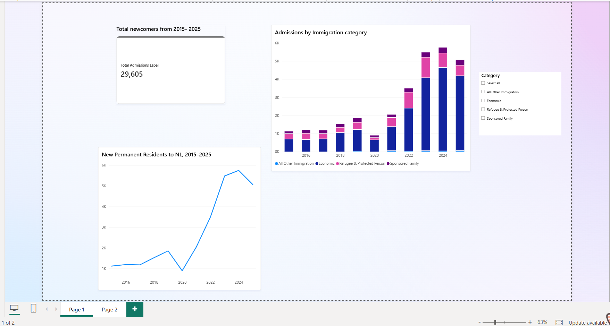
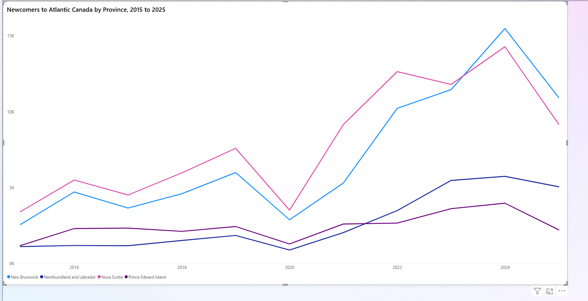

# Newcomers to Newfoundland and Labrador — Power BI Dashboard

An interactive Power BI dashboard analyzing new permanent residents to Newfoundland and Labrador (NL) from 2015 to 2025, with a comparison across the four Atlantic provinces.

## Key findings

- **About 5× growth:** annual admissions to NL rose from roughly 1,100 in 2015 to 5,750 in 2024 (29,605 admissions in total over 2015–2025).
- **Economic programs lead:** about 72% of newcomers arrived through economic immigration programs.
- **Refugee admissions peaked in 2023** (1,135), then roughly halved.
- **NL held up best in Atlantic Canada:** from 2024 to 2025, admissions fell about 12% in NL, compared with 29% in New Brunswick, 36% in Nova Scotia and 44% in Prince Edward Island.

## Data source

Immigration, Refugees and Citizenship Canada (IRCC) open data on new permanent residents, published on the Government of Canada Open Government Portal.

> TODO: paste the exact dataset link and the date you downloaded it here.

Contains information licensed under the Open Government Licence – Canada.

## How the data was cleaned

The raw file was not analysis-ready: it had stacked header rows, all provinces listed in a single column, and privacy-suppressed values shown as `--`. In Excel and Power Query I:

1. Removed the extra header rows.
2. Used **Fill Up** to label each row with its province and category.
3. Filtered to the province(s) needed.
4. **Unpivoted** the year columns into a single Year / Admissions structure.
5. Set correct data types for every column.
6. **Validated** the cleaned totals against the totals in the source file.

All steps are saved in Power Query, so the pipeline is refreshable: replace the source file, click **Refresh**, and every cleaning step reruns.

## Dashboard features

- DAX measures (`SUM`, `FORMAT`) for totals and labels
- KPI cards for headline figures
- Line chart of admissions over time
- Stacked column charts by immigration category
- Category slicer for interactive filtering

## Limitations

- IRCC suppresses small values for privacy (`--`). These cannot be counted, so totals for small categories may be slightly understated.
- Figures are admissions of new permanent residents. They do not show how many newcomers stayed in the province afterward.

## Repository contents

| File | Description |
|---|---|
| `NL_Newcomers_Dashboard.pbix` | Power BI report file |
| `data/` | Source data file from IRCC |
| `screenshots/` | Dashboard images |

## Tools

Power BI Desktop · Power Query · DAX · Excel

---

**Author:** Opemipo Ayenimelo, Computer Science graduate student, Memorial University of Newfoundland
